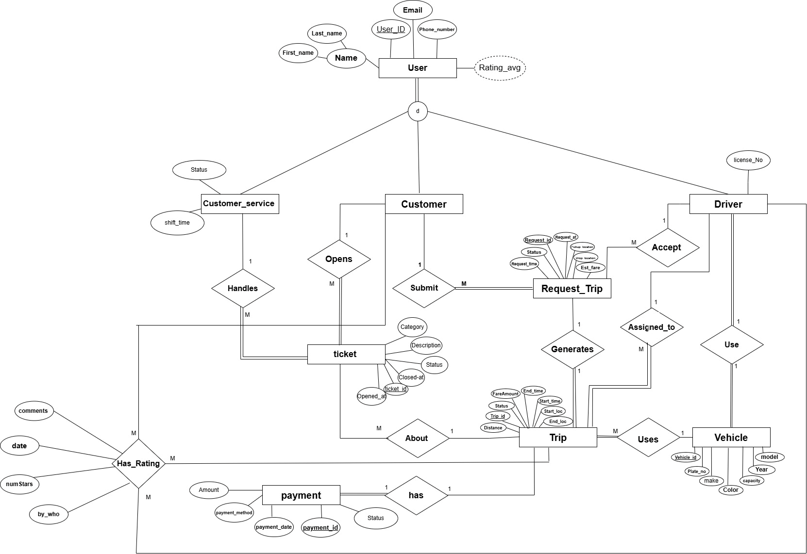

  

# Wsslini Database System

A relational database for **Wsslini**, a ride-booking platform similar to modern smart-transportation apps. It stores and connects customers, drivers, vehicles, trip requests, trips, payments, ratings, and customer-support tickets.

This repository contains **Phase 3** of a course project for **IS 220 – Database Fundamentals** (First Semester 2025). The project was developed and tested successfully on **Oracle Database** using **Oracle SQL Developer** during the course.

## Contents

| File | Description |
|---|---|
| [`docs/wsslini-phase3-report-redacted.pdf`](docs/wsslini-phase3-report-redacted.pdf) | The Phase 3 report: requirements, users and tasks, ERD, relational schema, table creation, data insertion, and SQL queries with their execution output |
| [`sql/original/Queries1.sql`](sql/original/Queries1.sql) | The project's original SQL query file |
| [`docs/images/erd.png`](docs/images/erd.png) | The Entity-Relationship Diagram, taken from the report |

## Overview

Customers submit trip requests with pickup and drop-off locations. Available drivers, each assigned to a vehicle, accept the requests. Each trip records its time, distance, and fare. After the trip, the customer pays through the system, and the customer and driver rate each other. If a problem occurs, the customer opens a support ticket, which is handled by customer service according to their shift schedule.

| User | Main tasks |
|---|---|
| Customer | Request trips, view trip status, pay, rate trips |
| Driver | Accept trip requests, start and end trips, update availability |
| Customer Support | Handle inquiries and complaints, monitor trips and payments |

## Database design

The ERD maps to nine tables: **Customer**, **Driver**, **Customer_Service**, **Vehicle**, **Request_Trip**, **Trip**, **Payment**, **Has_Rating**, and **Ticket**. The full relational schema, the `CREATE TABLE` statements, and the sample data are documented in the report.

## SQL queries

`sql/original/Queries1.sql` contains the project's queries:

- `WHERE` + `BETWEEN`: trips with a fare between 20 and 30
- Nested query with `MAX`: customers who gave the highest rating
- `UNION`: all customers and drivers in one list
- `COUNT`: number of unpaid payments
- `GROUP BY` + `HAVING`: shift times of active customer-service employees
- `JOIN`: drivers and the vehicles they use
- `UPDATE`: change a customer-service employee's shift
- `DELETE`: remove a specific rating

The report also presents a `GROUP BY` query that counts vehicles per make; that query appears in the report but not in `Queries1.sql`.

The queries run against the tables and sample data described in the report. The table-creation and data-loading steps are shown in the report; they are not included as separate SQL files. `UPDATE` and `DELETE` modify data, so run the queries only in a practice schema.

## Course context

IS 220 – Database Fundamentals · Course project, Phase 3 · Department of Information Systems, College of Computer and Information Sciences · First Semester 2025

## Team

- Mayar Algoot
- Shadan Alghonaim
- Luluh Aldhafiri
- Sarah Alshahwan
- Hadeel Aluomi

## Privacy

Student IDs and the ID column heading were removed from the report's cover page, and the PDF metadata was stripped. The rest of the report is unchanged. All customer, driver, and staff names, email addresses, and phone numbers in the sample data are fictional.
